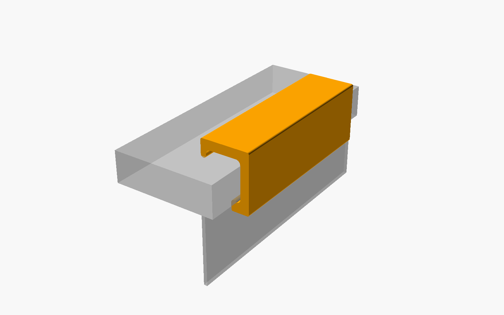

# Dry Box Clip

Parametric snap clip for a filament dry box. One printed part, no screws.

The clip is a C-spring. The gap between its upper tooth and bottom ridge is a
little smaller than the lid + rim stack. Push it on from the side, and it
presses the lid onto the gasket.

## Use

1. Measure from the underside of the box rim to the lid top.
2. Open `dry_box_clip.scad` in OpenSCAD and set `stack` in the Customizer.
3. Export `part = "clip"` (print orientation):
   `openscad -o clip.stl -D 'part="clip"' dry_box_clip.scad`

| Parameter         | Meaning                                             |
| ----------------- | --------------------------------------------------- |
| `stack`           | Rim underside to the lid surface under the tooth    |
| `preload`         | Gap is this much smaller than `stack` (tighter fit) |
| `top_reach`       | Reach of the upper tooth over the lid               |
| `top_tooth_depth` | Depth of the upper tooth below the top jaw          |
| `bottom_reach`    | Reach of the bottom ridge under the rim             |
| `width`           | Clip length along the box edge                      |
| `spine_t`         | Spine thickness (thinner = softer spring)           |

## Print

- Lay the clip on its side (as exported). No supports needed.
- PETG recommended. PLA can crack or lose tension.
- 4+ walls.
